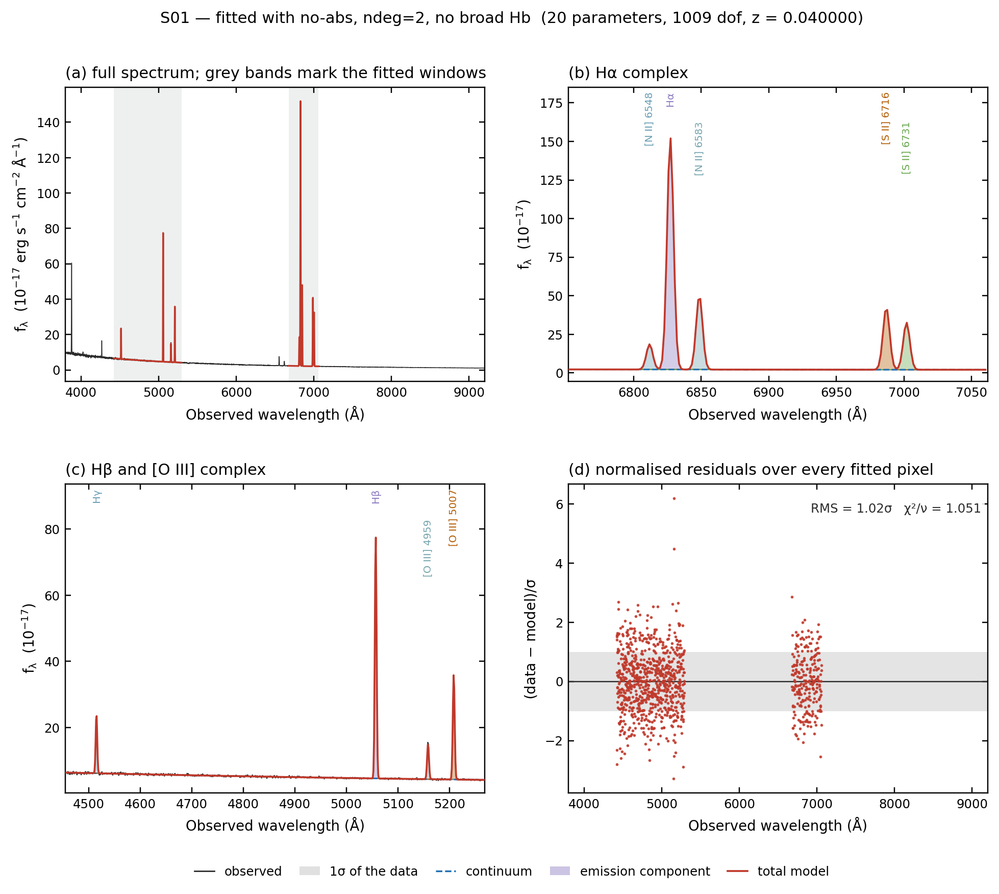
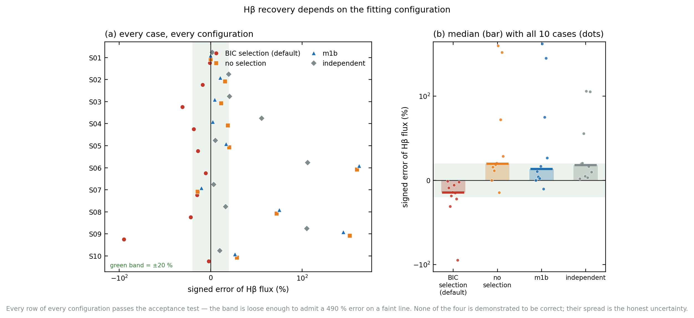
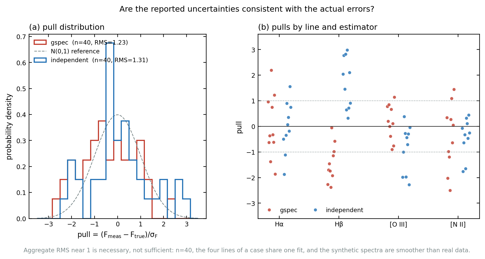
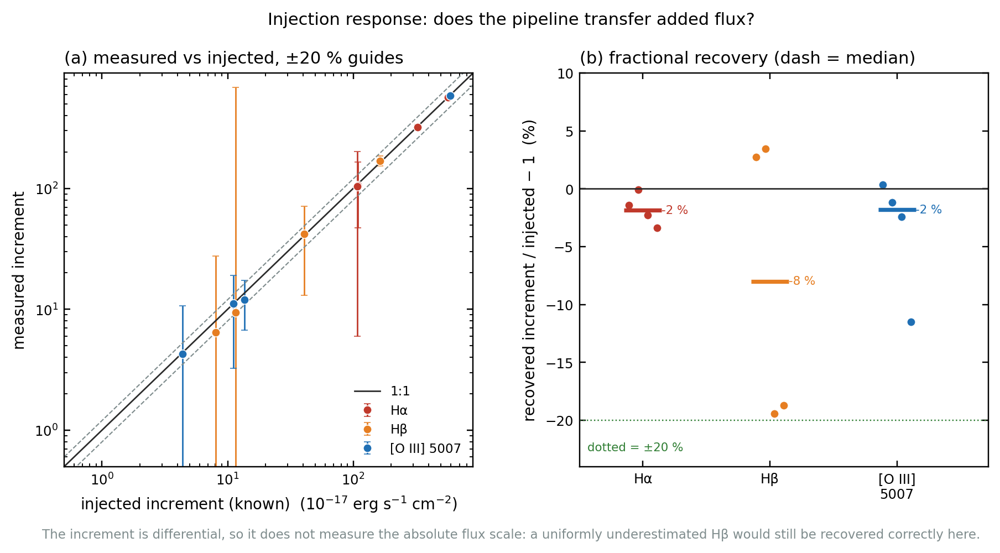
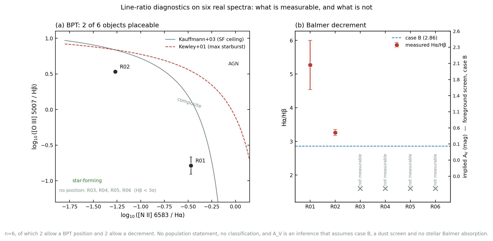

# Measuring galaxy redshifts and optical emission-line fluxes

**A model-based pipeline for SDSS spectroscopy, with uncertainties tested against
external truth.**

Ana Sofía Marulanda-Duque · v0.1 · [data provenance](DATA.md) ·
[licence](#10-data-provenance-and-licensing)

---

## Abstract

An optical spectrum of a galaxy is the sum of starlight — a smooth pseudo-continuum
crossed by absorption features — and line emission from ionised gas. Recovering the
redshift and the integrated fluxes of the strongest lines from that mixture underpins
star-formation rates, metallicities and ionisation diagnostics. This repository implements
the measurement as an explicit, bounded model and tests it against ground truth that does
not come from its own fitter.

`gspec` measures, from a flux-calibrated spectrum of unknown redshift, the redshift, the
continuum-subtracted integrated fluxes of Hα λ6565, Hβ λ4863, [O III] λ5008 and [N II]
λ6585, a 1σ uncertainty and a quality flag on each. The method is a joint fit of the Hα and
Hβ complexes at one shared redshift: a low-order polynomial continuum, a multiplicative
stellar-absorption term, Gaussian components with fixed atomic doublet ratios, the
instrumental line-spread function in quadrature per pixel, and the parameter covariance
propagated into the flux uncertainty.

On ten synthetic spectra with analytic truth, the redshift is recovered to a median of
1.7 km s⁻¹ (worst 18.5 km s⁻¹), and Hα, [N II] and [O III] to median errors of
−0.7 %, −1.5 % and +0.3 %. Hβ is different in kind: its median error is −14 %, and the
sign of that error changes when the model-selection step is disabled. The central
result is therefore a sensitivity rather than an accuracy figure: **Hβ responds to
modelling choices by more than the tolerance against which the pipeline is validated**,
which constrains any diagnostic built on it. The absorption term is included because
it is physically motivated, not because it has been shown to help: model selection
rejects it on the synthetic spectra, and retaining it degrades Hβ recovery.

The sample is twenty spectra, six real: a methodological study, not a survey of galaxies.

---

## 1. Introduction

### 1.1 What a galaxy spectrum contains

Between 3800 and 9200 Å a galaxy spectrum is dominated by starlight: a pseudo-continuum
crossed by absorption features — the Balmer series, Ca II H and K, the G band, the Mg Ib
triplet. Superimposed is emission from gas ionised by young massive stars, or by an
accretion flow, that recombines and cools.

They differ in a way that makes the mixture tractable: stellar absorption is broad, being
the integrated light of stars spanning a range of velocities, while H II-region emission is
narrow, comparable to or below the instrumental resolution. A continuum plus Gaussian
lines is therefore a reasonable description, and the difficulty lies not in its shape but
in the degeneracies between its parts.

### 1.2 Lines as redshift indicators

The observed wavelength of a feature is $\lambda_{\rm obs}=\lambda_{\rm rest}(1+z)$, so
the position of the line pattern measures $z$ directly. Because the pattern matters
rather than any single line, a matched filter against known line positions proposes
candidates robustly even when individual lines are faint — the approach the SDSS
pipeline takes (Bolton et al. 2012).

Redshift estimation has a failure mode that shapes the design here: within one narrow window
a shift in redshift is nearly degenerate with a rescaling of widths and amplitudes, so a fit
started at the wrong redshift can slide to a local minimum, return a plausible width and
appear to succeed. The remedy is structural — two widely separated windows fitted jointly,
sharing one redshift.

### 1.3 Why integrated fluxes

Photoionisation models and diagnostic diagrams consume the integrated flux of a line,
$F=\int f_\lambda\,d\lambda$, not the peak density, because integrated fluxes are
insensitive to resolution and binning. Hα traces recent massive-star formation; Hβ anchors
the Balmer decrement, the standard reddening indicator; [O III] λ5008 responds to the
ionisation parameter; [N II] λ6585 is a metallicity-sensitive neighbour of Hα that must be
separated from it before either flux means anything.

### 1.4 Why the measurement is difficult

Five effects dominate the error budget, each addressed in the model rather than left
to the optimiser.

*Blending.* Hα λ6565 lies within 20 Å of [N II] λ6548 and λ6583, and Hβ λ4863 within 100 Å
of [O III] λ4960 and λ5008; a window centred on one line sums its neighbours, so every line
is fitted as part of its complex.

*Stellar absorption.* The continuum is not smooth where it matters most: Balmer absorption
sits at exactly the wavelengths being measured, so in galaxies with a substantial
intermediate-age population unmodelled absorption removes part of the Hβ flux and biases it
low. That is the classic systematic of Balmer-line work, it is why the model has an
absorption term, and it is why Hβ is the least secure flux.

*Instrumental resolution.* The observed profile is the intrinsic profile convolved with the
line-spread function; both are approximately Gaussian, so their variances add. Adding widths
linearly inflates the Hα flux by 40 % on the reference case; ignoring the line-spread function
deflates it by 19 %.

*Noise, masking and continuum shape.* A pixel with zero inverse variance means "no
information", not "zero variance". Over a 370 Å window a low-order polynomial is an
adequate continuum, but its residual mismatch dominates the faintest lines; a
template-based stellar fit would be better, and is not implemented here (Cappellari &
Emsellem 2004).

---

## 2. The observations

### 2.1 SDSS spectra

The Sloan Digital Sky Survey obtained spectra of nearly a million galaxies during its
Legacy phase with a dedicated 2.5 m telescope at Apache Point Observatory (York et al.
2000; Stoughton et al. 2002; Abazajian et al. 2009), reducing them homogeneously and
measuring redshifts with a documented pipeline (Bolton et al. 2012). The spectra used
here come from that survey, reduced with `run2d=26` and retrieved through Data Release
18 (Almeida et al. 2023).

Each science extension is a table with one row per pixel: flux density in units of
10⁻¹⁷ erg s⁻¹ cm⁻² Å⁻¹, the base-10 logarithm of the observed vacuum wavelength, the
inverse variance, two quality-mask integers, and the instrumental width in pixels. The scale
is logarithmic, so the pixel width is
$\Delta\lambda=\lambda\ln10\,\Delta\log_{10}\lambda$ — about 1.57 Å at Hα and 2.12 Å at
9200 Å; one global Δλ would bias every width by up to 10 %. The spectra span 3800–9200 Å at
$R\approx2000$, an instrumental width of about 64 km s⁻¹ at Hα, read from `wdisp` rather than
assumed.

### 2.2 The case format and the redaction

The twenty spectra are converted to a uniform "case" schema: one FITS table with those
six columns plus `CASEID`, `BUNIT` and `PROVEN`. Values of `flux` are byte-identical to
the archive `COADD` column, so the conversion changes no measurement.

For the six real spectra, material was removed first: the fourth extension, holding the SDSS
pipeline's own line fluxes — the answers; `SPECOBJ` and the `PLATE`, `MJD`, `FIBERID`, `RA`,
`DEC` keywords, which identify the object; and the `sky` and `model` extensions, which would
supply a free starting model (recorded per file in [DATA.md](DATA.md) §3). Six of ten
retrieved spectra became cases, spanning $z=0.021$–0.085; one (R05) is a broad-line object
the model constrains poorly.

### 2.3 Synthetic and injected spectra

Real spectra have no exact known line fluxes, and published catalogues disagree by tens of
per cent to factors of two, so a catalogue cannot be truth for a few-per-cent claim. Two
independent sources of truth are constructed instead.

Ten synthetic spectra are generated from known parameters: three power-law continuum
components times a twelve-line absorption pattern, Gaussian lines whose integral is the
declared flux, and noise from a prescribed signal-to-noise curve. The generator uses a
continuum basis the fitter does not assume, so a fit that merely reproduces the generator
cannot pass. The cases span $z=0.021$–0.088 and are reproducible bit for bit from a
documented seed.

Four injection spectra are copies of real spectra with one line of exactly known flux
added, at 40 % of that line's measured flux. Copy and base share one noise realisation,
so the difference of two measurements recovers the increment exactly whatever the
object's true flux is — the only exact truth available for real data.

---

## 3. Objectives

The study asks how accurately the redshift and the four strongest optical emission lines
can be recovered from survey-quality spectra under a stated model, and how trustworthy the
attached uncertainties are. Four objectives follow: the redshift, without assuming a
catalogue value; the four fluxes, with genuine accuracy distinguished from
threshold-passing; a 1σ that describes the error actually made, tested through the pull
distribution; and, per line, a detection flag plus the identity of the model the data
selected (§6.5). The dataset is twenty spectra: a methodological study, not a population
study.

---

## 4. Method

### 4.1 The model

Within each window the model is

$$f(\lambda)=C(\lambda)\prod_i\bigl[1-d_i G_i(\lambda)\bigr]+\sum_j A_j G_j(\lambda),$$

with $G(\lambda;\mu,\sigma)=\exp[-\tfrac12((\lambda-\mu)/\sigma)^2]$, $A_j$ a peak
amplitude in flux-density units, and $C$ a polynomial in a normalised rest-frame
coordinate,

$$C(\lambda)=\sum_{k=0}^{n}c_kx^k,\qquad x=\frac{\lambda/(1+z)-\lambda_c}{\Delta\lambda_c},$$

so coefficients are comparable between windows of different width; the order $n$ is one of
the quantities model selection may choose. Two windows are fitted: rest-frame 6420–6790 Å
([N II] λ6548, Hα narrow and broad, [N II] λ6583, [S II] λ6716/6731) and 4250–5090 Å (Hγ,
Hβ narrow and broad, [O III] λ4959/5007). The doublet ratios are fixed at their atomic values,
$I(6583)/I(6548)=2.94$ and $I(5007)/I(4959)=2.98$, as exact ties — a modelling choice, not a
physical law, since real gas with dust and shocks varies by tens of per cent. Ties remove two
parameters per complex and make the doublets constrain the line width.

### 4.2 The absorption term, and what it does not do

The absorption factor in equation (1) is a multiplicative attenuation built from Gaussian
features at the Balmer wavelengths and the G band, with one depth scale and one width. The
width is not free: it is tied to the narrow Hβ emission width, widened by $\exp\rho$ with
$\rho\ge\ln1.15$. The prior encodes a real asymmetry — stellar absorption is broader than
H II-region emission, because stars sample the whole galaxy while the gas is kinematically
cold — and stops the fit trading depth against a spurious broad component.

What the term is **not** matters as much. It is a phenomenological attenuation of a
low-order polynomial, not a stellar-population fit: no template spectra, no population
synthesis, no decomposition of the observed light into stellar and nebular parts. It can
absorb part of the effect of stellar absorption and is selected on five of six real
spectra, but **this project does not demonstrate that the pipeline separates stellar from
nebular contributions**, and no result here should be read as a measurement of stellar
absorption; whether the fitted depth approaches the true one is a question the synthetic
experiments answer in the negative (§6.6).

### 4.3 Broadening, joint fit, and flux

Intrinsic and instrumental profiles are both approximately Gaussian, so their
convolution has the sum of variances,

$$\sigma_{\rm obs}^2=\sigma_{\rm int}^2+\sigma_{\rm LSF}^2,\qquad
\sigma_{\rm LSF}=\texttt{wdisp}\times\Delta\lambda,$$

evaluated per pixel. Because convolution preserves area, the integral of the observed
profile is the true flux; deconvolving before integrating would be wrong.

Both windows are fitted simultaneously with one shared redshift, which breaks the degeneracy
of §1.2: one window can absorb a redshift error into its widths, two windows 1 500 Å apart
cannot. The redshift is bounded to ±0.0035 around its seed, the widths to physical ranges
(25–600 km s⁻¹ narrow, 250–1 800 broad), and the solve is a bounded least-squares fit with
analytic Jacobian scaling and tolerances of 10⁻¹⁰ — deterministic by construction. A
reported flux is the integral of the observed profile,

$$F=A\sqrt{\sigma_{\rm int}^2+\sigma_{\rm LSF}^2}\sqrt{2\pi},$$

summed over a line's components when it has a narrow and a broad part. Amplitude and
flux are not interchangeable: on the reference case the Hα amplitude is 150.4 and the
integrated flux 901.3, a ratio of $\sqrt{2\pi}\sigma_{\rm obs}=5.98$.

### 4.4 Uncertainty, selection and flags

The covariance comes from the Jacobian at the solution,

$${\rm Cov}(\mathbf p)=(\mathbf J^{\!\top}\mathbf J)^{+}\min\!\left(\frac{\chi^2}{\nu},1.5\right),$$

propagated to the flux by first order, $\sigma_F^2=\nabla F^{\top}{\rm Cov}(\mathbf
p)\nabla F$, with $\nabla F$ from finite differences of the same function integrated, so a
change to the flux formula cannot leave the uncertainty behind. The
scale factor inflates the covariance when the fit is poorer than its degrees of freedom
imply, capped so a misspecified model cannot claim an arbitrarily defensive error bar.
The estimator has a known weakness (§6.7).

Seven candidate models are fitted at the selected redshift — varying the continuum order,
whether broad components are allowed, and whether the absorption term is present — and the
one with the lowest ${\rm BIC}=\chi^2+k\ln n$ is kept (Schwarz 1978). The selection travels
with the result: model, parameters, degrees of freedom and bound parameters are all
returned. Each line is flagged `ok` when $|F|/\sigma_F\ge3$ and `nondetection` below; the 3σ
rule
is a reporting convention, not a detection theory, and 9 of the 80 shipped rows lie within
a factor 1.5 of that boundary.

---

## 5. Validation

A measurement validated against its own fitter establishes only self-consistency. Three
tiers of external evidence are used.

**Analytic synthetic truth** — ten spectra with known parameters from a generator that
shares no code with the fitter and uses a different continuum basis, so agreement cannot
come from shared assumptions; the only tier in which absolute flux accuracy is measurable.

**Differential injection** — a line of exact known flux added to real spectra and
differenced against its base, so the unknown true flux cancels while real noise,
continuum, masks and resolution remain. It measures the slope of the response, not the
absolute scale.

**Catalogue comparison**, only as a plausibility band: the SDSS pipeline and the MPA-JHU
catalogue (Brinchmann et al. 2004) give fluxes for the same objects, but agreement bounds how
wrong a measurement can be without showing that it is right.

A fourth tier is a program written independently against the same problem — a
radial-basis-function continuum, a bounded optimiser and a bootstrap, sharing no estimator
with this package. It exists to test whether the Hβ behaviour of §6.5 is a property of this
model or of the problem. Its measurements, its outputs and the comparison tables ship in
[`validation/independent/`](validation/independent/), and the analysis is
[`validation/report.md`](validation/report.md) §5.

---

## 6. Results

### 6.1 Redshift

On the ten synthetic spectra the recovered redshift differs from the analytic value by a
median of 1.7 km s⁻¹ and a maximum of 18.5 km s⁻¹, a small fraction of one resolution element.
On real spectra it is validated indirectly: the injected copies recover their base redshift.

### 6.2 Emission-line recovery

| line | median signed error | range |
|---|---|---|
| Hα λ6565 | **−0.70 %** | −3.4 … +41.6 % |
| Hβ λ4863 | **−14.4 %** | −94.7 … −1.0 % |
| [O III] λ5008 | **+0.31 %** | −65.5 … +44.8 % |
| [N II] λ6585 | **−1.54 %** | −7.7 … +5.4 % |

Hα, [N II] and [O III] are recovered to about one per cent at the median, the spread dominated
by the faintest lines where flux is comparable to its own uncertainty. Hβ differs in kind
rather than size: its error is negative in all ten cases under the default configuration, and
its magnitude spans two orders of magnitude.

### 6.3 Injection response

| line | recovery of the injected increment (median, n = 4) | range |
|---|---|---|
| Hα | 98.1 % | 96.6 – 99.9 % |
| [O III] λ5008 | 98.2 % | 88.5 – 100.3 % |
| Hβ | 92.0 % | 80.6 – 103.5 % |

The pipeline is close to linear in added flux and does not systematically swallow a real
increment; Hβ's lower median is the weakness of §6.2 measured differentially. The test
cannot detect a uniform scale error, however: an implementation underestimating every Hβ
flux by 40 % would still return a correct increment.

### 6.4 Uncertainties

For a measurement $F$ with uncertainty $\sigma_F$ and truth $F_{\rm true}$, the pull
$p=(F-F_{\rm true})/\sigma_F$ is standard normal if σ_F is the standard deviation of the
measurement error. Over the forty synthetic line fluxes the pull RMS is 1.23, the
largest |p| is 2.50, and none exceeds 3σ: the uncertainties are calibrated in the
aggregate sense that matters operationally, neither systematically optimistic nor
padded. This is necessary rather than sufficient — the forty rows are not independent
(four lines share one fit per spectrum) and synthetic noise is smoother than real data.

### 6.5 Hβ responds to the configuration

The central result concerns method. Fitting the same spectra under configurations differing
only in model-selection choices gives:

| configuration | median Hβ error |
|---|---|
| default (BIC selection over seven candidates) | **−14 %** |
| identical constants, model selection disabled | **+20 %** |
| alternative configuration (quadratic continuum, wider windows) | **+14 %** |
| independently written implementation | **+18 %** |

The sign of the error flips with the model: the default under-predicts, both configurations
retaining the absorption term over-predict. Switching model selection off alone is worth about
34 percentage points of Hβ — more than the 20 % tolerance the pipeline is validated against.
Reporting "Hβ to 14 %" without stating the configuration
reports a choice, not a measurement. All three ship as objects in `gspec.variants`.

The mechanism links to §4.2: Hβ lies where Balmer absorption is strongest. Selection rejects
the absorption term on the synthetic spectra because their absorption is weak, so part of Hβ
is absorbed by an unmodelled feature and comes out low; with the term retained the fit can
overshoot on faint lines. A second, independently written implementation occupies the
overshoot side too (+18 %), and the analytic truth falls between the reference and that
implementation in **all ten** cases. Neither is demonstrated to be correct: the evidence is
consistent with a model that cannot fully resolve the two contributions.

### 6.6 The absorption term does not improve Hβ

The term was added for the reason set out in §1.4 and is selected on five of six real
spectra. On this dataset it does not earn its place: retaining it where selection would remove
it moves the median Hβ error from −11 % to +20 %, and where a synthetic truth exists the
recovered depths scatter widely about the true value while the fitted width sits on its prior
bound in several cases. It is reported as a negative result because it is one, and **no claim
is made anywhere in this repository that it improves Hβ accuracy**.

### 6.7 The covariance estimator has a known failure

When an amplitude is pinned against its bound the corresponding direction is unconstrained,
and the pseudoinverse distributes variance too small or too large. Conditioning the
covariance on the bound shrinks the formal uncertainties and flips detection flags, but
degrades the calibration of §6.4, so it was rejected. On such rows σ_F is also sensitive to
the linear-algebra backend — enough to change a detection flag — hence the pinned versions.

---

## 7. Interpretation and limitations

Redshift is recovered to a few km s⁻¹ and three of the four strong lines to about one per cent
at the median, with 1σ uncertainties that behave like standard deviations; the pipeline is
deterministic and its failure modes are labelled and tested.

Hβ is not a 14 % measurement. The defensible statement is that it carries a
configuration-dependent spread of roughly ±15–20 %, the median moving from −14 % to +20 %,
and that no configuration here has been shown to be correct. Any quantity built on Hβ
inherits that spread; passing a threshold is a statement about the threshold, since all three
configurations meet every row, including rows where Hβ is far from its true value.

The consequences propagate. The Balmer decrement $D={\rm H}\alpha/{\rm H}\beta$ is the
standard reddening indicator, with

$$E(B-V)=\frac{2.5}{k({\rm H}\beta)-k({\rm H}\alpha)}\log_{10}\!\left(\frac{D}{D_0}\right),$$

$D_0=2.86$ the case-B value (Osterbrock & Ferland 2006) and $k(\lambda)$ the extinction
curve (Cardelli, Clayton & Mathis 1989). Because $D\propto1/F_{{\rm H}\beta}$, a 20 %
underestimate of Hβ raises $D$ by 25 % and shifts $A_V$ by about 0.7 mag — well inside the
spread of §6.5. That is arithmetic, not a measurement, but it shows why any extinction from
this pipeline
must carry the sensitivity, and why every diagram whose vertical axis is [O III]/Hβ (Baldwin
et al. 1981; Veilleux & Osterbrock 1987; Kewley et al. 2001; Kauffmann et al. 2003) inherits
it. The exploratory diagnostics that use these ratios appear in Figure 5; their treatment,
with the small-sample caveat, is in [`docs/figures.md`](docs/figures.md) §5.

Twenty spectra, six real, one a broad-line object the model constrains poorly: nothing here
supports a statement about populations, luminosity or mass dependence, or any property the
pipeline does not measure. The forward-looking statement is narrow — a stellar continuum
fitted from population synthesis rather than a single tied Gaussian (Cappellari & Emsellem
2004) is the most promising route to a defensible Hβ, and it is not implemented here.

---

## 8. Figures

Each figure is produced by a script in `validation/figures/`, from the committed data, with
no number typed by hand; `make_all.py` regenerates all five and records their hashes. The
full treatment — question, equations, what each figure does and does not establish — is in
[`docs/figures.md`](docs/figures.md).



**Figure 1 — the reference case decomposed.** The observed S01 spectrum with its 1σ band,
the fitted continuum, each emission component drawn on top of that continuum, the total
model, and normalised residuals over every fitted pixel. χ²/ν = 1.051, all four lines
within 1 % of truth — but one well-fitted spectrum is not a validation: S09's Hβ is 94.7 %
low and its residuals look equally unremarkable (§6.2).



**Figure 2 — Hβ depends on the configuration.** Signed Hβ error for every synthetic spectrum
under the three configurations of §6.5. The sign flips with the model: every configuration
that retains the absorption term over-predicts. Every row passes the acceptance test, including the one
where Hβ is nearly six times its true value — which is the point.



**Figure 3 — are the uncertainties honest?** Pull distributions for the reference and the
independently written implementation against a standard normal, n = 40 each. Both are calibrated in the aggregate
(RMS 1.23 and 1.31) with no tail — necessary but not sufficient, since the four lines of a
case share one fit (§6.4).



**Figure 4 — injection response.** Measured against the known injected increment on
logarithmic axes, with the 1:1 line and ±20 % guides. This is a differential test: it
measures the slope of the response and is blind to the absolute flux scale, which is why it
complements Figure 2 rather than repeating it (§6.3).



**Figure 5 — exploratory line-ratio diagnostics.** BPT position for the two of six real
spectra with a measurable Hβ, with the Kauffmann et al. (2003) and Kewley et al. (2001)
reference curves, and the Balmer decrement with case B marked. The four objects without a
measurable Hβ are named in the panel rather than plotted, and no population statement is
made from two points ([`docs/figures.md`](docs/figures.md) §5).

---

## 9. Reproducibility

```bash
git clone https://github.com/ASMarulanda/galaxy-spectroscopy
cd galaxy-spectroscopy
python -m venv .venv && source .venv/bin/activate
pip install -e ".[dev]"
```

Python 3.12. The pins in `pyproject.toml` (numpy 1.26.4, scipy 1.11.4, astropy 7.0.0) are
part of the experiment: every number here was produced under them.

```python
import gspec

case = gspec.read_case("data/cases/S01.fits")
result = gspec.measure(case)

result.redshift                                  # 0.03999954
result.lines["Halpha"].flux                      # 901.331
result.lines["Halpha"].flux_err                  # 1.3898
result.model_selected                            # 'no-abs, ndeg=2, no broad Hb'
result.chi2dof, result.n_par, result.at_bounds   # diagnostics travel with the numbers
```

Batch use is `gspec measure --cases data/cases --out line_measurements.csv`;
`python tools/walkthrough_s01.py` prints every intermediate for one case. Every figure in
this document is regenerated by `python validation/figures/make_all.py` (about six minutes),
which also records the software versions and the SHA-256 of each input and output in
`FIGURE_MANIFEST.json`.

The suite (`pytest`, 212 tests, about four minutes) is organised by failure mode: FITS and
units, the quadrature identity, Gaussian integration, accuracy against truth, redshift
recovery, the injection identity, uncertainty calibration, a negative control that must
fail, regression against a frozen baseline, bit-for-bit regeneration of the synthetic data,
and — from V0.3 — archive retrieval against a faked HTTP server and the conversion of a real
archive file back into the case it was made from. The shipped baseline is reproduced
exactly, so every number here is recomputable. Ten of the 212 are `characterisation` tests:
they pin the golden baseline to its printed digits and hold only on the reference stack, so
CI runs `pytest -m "not characterisation"` and the reasons are in
[`docs/limitations.md`](docs/limitations.md) L17.

### Measuring a spectrum of your own

The same pipeline runs on spectra fetched from the SDSS archive, because the
retrieval step adapts the input rather than the fitter:

```bash
python tools/download_sdss.py --plate 294 --mjd 51986 --fiber 36 --out data/raw
gspec measure --cases data/raw/cases --out data/raw/measurements.csv
```

The first command validates the identifiers, fetches
`spec-0294-51986-0036.fits` from the DR18 archive, checks the transfer's size and
SHA-256, verifies the FITS structure — the log-linear grid against `COEFF0`/`COEFF1`,
the flux-density unit, the inverse-variance coverage, and that `wdisp` behaves like
a width in pixels and not in ångström — and writes a case file plus a JSON record
of every hash involved. Nothing is resampled, smoothed or renormalised, and a file
that violates the instrument contract is refused with its reasons rather than
coerced into the fitter.

[`docs/sdss-tutorial.md`](docs/sdss-tutorial.md) walks through it end to end with a
worked example, and
[`notebooks/sdss_workflow.ipynb`](notebooks/sdss_workflow.ipynb) runs the same
workflow with the physics explained: the archive's FITS layout, the logarithmic
grid, the resolution argument, the conversion, the measurement, and what the
quality flags do and do not mean.

---

## 10. Data provenance and licensing

The twenty spectra carry three provenance positions, itemised per file in
[DATA.md](DATA.md). The ten synthetic spectra are original work from a documented seed
(CC BY 4.0). The six real spectra are SDSS DR18 spectra redacted as in §2.2; SDSS states
that data in its public releases are in the public domain, and the acknowledgment and
citations in [DATA.md](DATA.md) §2 must accompany any reuse. The four injection spectra are
derivatives with a line of known flux added (CC BY 4.0 for that contribution). Code is MIT,
original text and synthetic data CC BY 4.0, third-party material excluded from both grants;
citation metadata is in [CITATION.cff](CITATION.cff).

How the candidate list was selected is undocumented: the provenance table's columns are
consistent with a selection on emission-line class and strength, but the query itself was not
preserved. Three such gaps are stated rather than reconstructed, and the provenance audit in
[DATA.md](DATA.md) §6 records what the shipped tables do and do not establish.

---

## 11. Status

**v0.1** was the measurement pipeline, its tests, its data and the introduction.
**v0.2** added the evidence layer: the five figures of §8, the independent
implementation and its comparison, the controlled experiments of §6.5–§6.7, and five
documents — [`docs/methods.md`](docs/methods.md),
[`docs/limitations.md`](docs/limitations.md), [`docs/figures.md`](docs/figures.md),
[`docs/validation-history.md`](docs/validation-history.md) and
[`docs/decision-log.md`](docs/decision-log.md) — with the full
[`validation/report.md`](validation/report.md).

**v0.3**, this release, closes the loop between the archive and the measurement:
`tools/download_sdss.py` retrieves a spectrum by its identifiers and verifies it,
`tools/fits_to_case.py` converts it to the case schema without touching a single
number, and the pipeline measures it. With it come
[`docs/sdss-tutorial.md`](docs/sdss-tutorial.md),
[`notebooks/sdss_workflow.ipynb`](notebooks/sdss_workflow.ipynb), and a continuous
integration workflow that runs the offline suite on every push. Nothing in the
measurement changed: the baseline of §9 is still reproducible byte for byte.

The scope is identifiers only. There is no catalogue query, and therefore no
selection function to declare: you say which spectrum, the tool fetches that
spectrum.

---

## References

Abazajian, K. N., et al. 2009, *The Seventh Data Release of the Sloan Digital Sky
Survey*, ApJS, 182, 543.
[doi:10.1088/0067-0049/182/2/543](https://doi.org/10.1088/0067-0049/182/2/543)

Almeida, A., et al. 2023, *The Eighteenth Data Release of the Sloan Digital Sky Surveys*,
ApJS, 267, 44. [doi:10.3847/1538-4365/acda98](https://doi.org/10.3847/1538-4365/acda98)

Baldwin, J. A., Phillips, M. M., & Terlevich, R. 1981, *Classification parameters for the
emission-line spectra of extragalactic objects*, PASP, 93, 5.
[doi:10.1086/130766](https://doi.org/10.1086/130766)

Bolton, A. S., et al. 2012, *Spectral Classification and Redshift Measurement for the
SDSS-III Baryon Oscillation Spectroscopic Survey*, AJ, 144, 144.
[doi:10.1088/0004-6256/144/5/144](https://doi.org/10.1088/0004-6256/144/5/144)

Brinchmann, J., et al. 2004, *The physical properties of star-forming galaxies in the
low-redshift Universe*, MNRAS, 351, 1151.
[doi:10.1111/j.1365-2966.2004.07881.x](https://doi.org/10.1111/j.1365-2966.2004.07881.x)

Cappellari, M., & Emsellem, E. 2004, *Parametric Recovery of Line-of-Sight Velocity
Distributions from Absorption-Line Spectra of Galaxies via Penalized Likelihood*, PASP,
116, 138. [doi:10.1086/381875](https://doi.org/10.1086/381875)

Cardelli, J. A., Clayton, G. C., & Mathis, J. S. 1989, *The relationship between infrared,
optical, and ultraviolet extinction*, ApJ, 345, 245.
[doi:10.1086/167900](https://doi.org/10.1086/167900)

Kauffmann, G., et al. 2003, *The host galaxies of active galactic nuclei*, MNRAS, 346,
1055. [doi:10.1111/j.1365-2966.2003.07154.x](https://doi.org/10.1111/j.1365-2966.2003.07154.x)

Kewley, L. J., et al. 2001, *Theoretical Modeling of Starburst Galaxies*, ApJ, 556, 121.
[doi:10.1086/321545](https://doi.org/10.1086/321545)

Osterbrock, D. E., & Ferland, G. J. 2006, *Astrophysics of Gaseous Nebulae and Active
Galactic Nuclei*, 2nd ed. (Sausalito, CA: University Science Books)

Schwarz, G. 1978, *Estimating the Dimension of a Model*, Annals of Statistics, 6, 461.
[doi:10.1214/aos/1176344136](https://doi.org/10.1214/aos/1176344136)

Stoughton, C., et al. 2002, *Sloan Digital Sky Survey: Early Data Release*, AJ, 123, 485.
[doi:10.1086/324741](https://doi.org/10.1086/324741)

Veilleux, S., & Osterbrock, D. E. 1987, *Spectral classification of emission-line
galaxies*, ApJS, 63, 295. [doi:10.1086/191166](https://doi.org/10.1086/191166)

York, D. G., et al. 2000, *The Sloan Digital Sky Survey: Technical Summary*, AJ, 120,
1579. [doi:10.1086/301513](https://doi.org/10.1086/301513)
